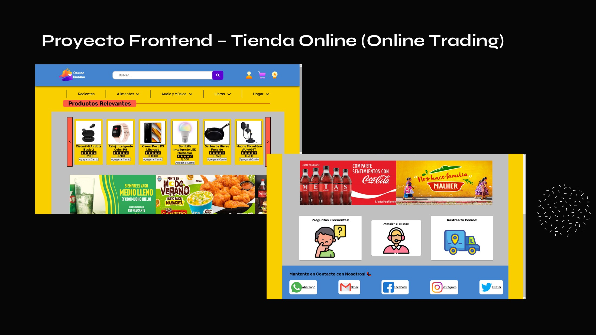
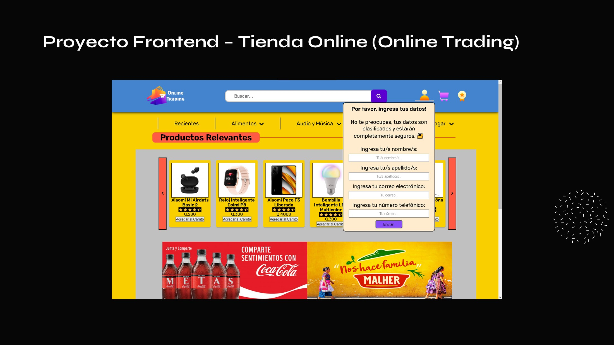

# Online Trading — Tienda Online Frontend

Interfaz frontend de una tienda en línea (**Online Trading**), desarrollada con **HTML5**, **CSS3** y **JavaScript**, orientada a la presentación de catálogo de productos, categorías desplegables, carrusel publicitario y captura de datos de cliente.

## Vista previa

| Catálogo principal y secciones informativas | Formulario desplegable de cliente |
| :---: | :---: |
|  |  |

## Características principales

- Encabezado con logotipo informativo desplegable, barra de búsqueda y accesos de usuario, carrito y favoritos.
- Menú horizontal de navegación con submenús por categorías (*Recientes*, *Alimentos*, *Audio y Música*, *Libros* y *Hogar*).
- Vitrina de productos relevantes con tarjetas interactivas (*hover*), calificación visual y precios en quetzales (`Q.`).
- Carrusel animado de banners publicitarios mediante `@keyframes` en CSS.
- Formulario desplegable de registro de cliente con alerta de confirmación en JavaScript (`main.js`).
- Tarjetas informativas (*Preguntas Frecuentes*, *Atención al Cliente*, *Rastrea tu Pedido*) y bloque de contacto con redes sociales.

## Tecnologías utilizadas

- **HTML5**
- **CSS3** (Flexbox, menús desplegables con `:hover` y animaciones `@keyframes`)
- **JavaScript** (lectura de campos del formulario en el cliente)
- **Font Awesome** y **Google Fonts** (`Rubik`, vía CDN)

## Contexto y estado del proyecto

- **Contexto:** Proyecto frontend estático con fines académicos.
- **Estado:** Maquetación estática finalizada (archivada para portafolio).

## Autor

**Daniel Alejandro Arita Leiva**
